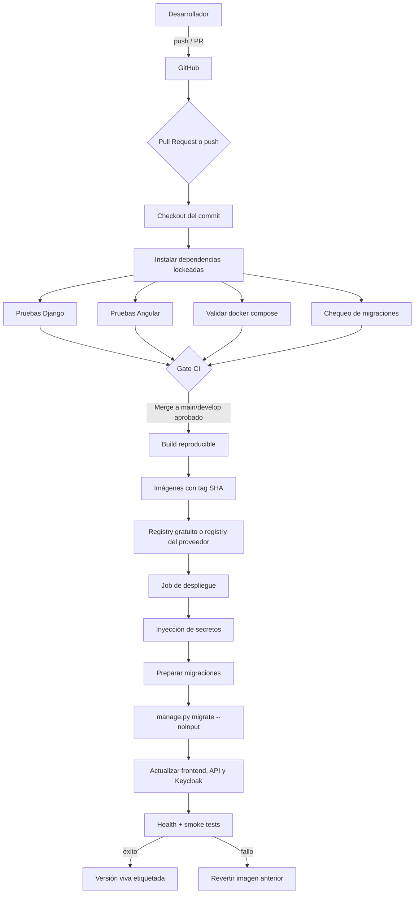
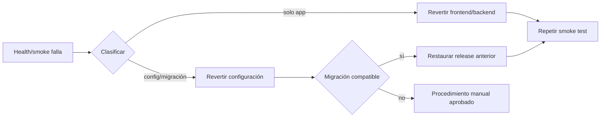

# Diseño de CI/CD de Piedrazul

**Estado:** propuesta de diseño, pendiente de implementación  
**Proveedor CI:** GitHub Actions  
**Ambientes:** local + académico único

## 1. Objetivo

Automatizar la integración y entrega de:

- Frontend Angular con SSR.
- API Django.
- Configuración de Keycloak.
- Migraciones de PostgreSQL.
- Artefactos y imágenes versionados por commit.
- Despliegue cloud y verificaciones posteriores.

La implementación debe evitar cargos e no activar planes de pago.

## 2. Diagrama de flujo



## 3. Branches y protección

### Desarrollo inicial

| Rama/evento | Acción |
|---|---|
| `develop` | CI completo y despliegue solo si el equipo lo aprueba |
| Pull request hacia `develop` | CI obligatorio |
| `main` | Rama candidata a producción académica |
| Tag | Artefacto release inmutable identificado por SHA |

Hasta que el equipo decida reglas definitivas:

- No permitir merge con CI fallido.
- Revisión mínima para cambios de seguridad, Docker, IaC y secretos.
- `main` protegida.
- No ejecutar despliegue desde forks.
- Un despliegue a la vez; usar concurrencia para evitar carreras.

## 4. Pipeline de integración

### Job backend

1. Usar Python 3.13.
2. Instalar `backend/requirements.txt`.
3. Levantar PostgreSQL para pruebas o usar servicio efímero.
4. Ejecutar chequeo de Django:

   ```text
   python manage.py check
   python manage.py makemigrations --check --dry-run
   python manage.py test
   ```

5. Guardar reporte JUnit si el runner lo genera.

### Job frontend

1. Usar Node 24 y `npm ci`.
2. Ejecutar tests sin modo interactivo.
3. Ejecutar:

   ```text
   npm run build -- --configuration production
   npm test -- --watch=false
   ```

4. Confirmar que el resultado corresponde a la configuración real de Angular SSR.

### Job Docker

1. Construir backend y frontend.
2. Validar Compose:

   ```text
   docker compose config
   docker compose build
   ```

3. Ejecutar servicios efímeros.
4. Comprobar puertos y endpoints básicos.

### Job de seguridad mínimo

1. `npm audit --omit=dev` para el frontend.
2. Escaneo de paquetes Python.
3. Escaneo de vulnerabilidades de imagen.
4. ZAP pasivo o activo únicamente dentro del alcance autorizado.

No bloquear por hallazgos informativos sin clasificar. Bloquear primero secretos expuestos, errores críticos comprobables y dependencias críticas con parche disponible.

## 5. Build y artefactos

Cada release debe producir identificadores estables:

```text
<registry>/<frontend>:<git-sha>
<registry>/<backend>:<git-sha>
<registry>/<keycloak>:<git-sha>
```

Keycloak puede usar imagen oficial más configuración versionada; no crear una imagen personalizada salvo que sea necesaria para el tema.

Los artefactos deben:

- No contener secretos.
- Ser reproducibles.
- Conservar el SHA en etiquetas.
- Tener digest inmutable preferiblemente sobre `latest`.
- Quedarse registrados al menos hasta completar rollback.

## 6. Despliegue

### Secuencia obligatoria

1. Validar que existen secretos requeridos.
2. Construir o descargar imágenes por SHA.
3. Aplicar o generar IaC.
4. Ejecutar migraciones una sola vez.
5. Desplegar backend.
6. Esperar el readiness del backend.
7. Desplegar frontend.
8. Desplegar/actualizar Keycloak sin reiniciar PostgreSQL.
9. Ejecutar health check y smoke test.
10. Registrar SHA y resultado.

### Migraciones

Django debe tener dos modos claramente separados:

- **Local:** aplica migraciones al iniciar para comodidad.
- **Cloud:** el job de despliegue ejecuta migraciones una vez; las réplicas no las ejecutan.

Toda migración debe ser compatible con el proceso de rollback; si elimina una columna usada por la imagen anterior, usar despliegue expandir/contratos.

## 7. Secrets

Secretos conceptuales:

| Nombre lógico | Uso |
|---|---|
| `DJANGO_SECRET_KEY` | Firma Django |
| `DJANGO_ALLOWED_HOSTS` | Hosts permitidos |
| `DB_NAME` | Base de la aplicación |
| `DB_USER` | Usuario Django |
| `DB_PASSWORD` | Contraseña Django |
| `KEYCLOAK_ADMIN_PASSWORD` | Bootstrap administrativo |
| `KEYCLOAK_DB_PASSWORD` | Base de Keycloak |
| `DEPLOY_*` | Credenciales específicas del proveedor |

Los workflows deben usar GitHub Actions Secrets o el gestor de secretos del proveedor. Nunca imprimirlos, escribirlos en artefactos ni usar valores por defecto en producción.

## 8. Smoke test mínimo

Después del despliegue:

1. `GET` al endpoint de salud del frontend.
2. `GET` al health check de API.
3. Discovery OIDC de Keycloak.
4. Inicio de sesión con cuenta sintética.
5. API rechaza token ausente o inválido.
6. Usuario sintético consulta agenda.
7. Cancelación válida en datos sintéticos.
8. Cancelación inválida por motivo o plazo.
9. Reporte anual con estructura esperada.

Los smoke tests no pueden usar datos reales ni imprimir tokens.

## 9. OWASP ZAP

ZAP debe ejecutarse después del despliegue:

- Alcance permitido declarado.
- Usuarios sintéticos.
- Preferir baseline pasivo inicialmente.
- Guardar resumen y evidencias sin cookies, Authorization, contraseñas ni datos personales.
- Activar pruebas agresivas solo con autorización expresa.

## 10. Rollback



Regla: no ejecutar un rollback que borre datos ni una migración destructiva automáticamente.

## 11. Entregables que debe producir el agente constructor

1. `.github/workflows/ci.yml`
2. `.github/workflows/deploy.yml` o workflow combinado.
3. Tests de salud y scripts smoke.
4. Dockerfiles separados para desarrollo y producción si el proyecto lo requiere.
5. Configuración dinámica de Angular.
6. Configuración segura de Django.
7. Política de secrets en GitHub.
8. Evidencia de run exitoso y fallido controlado.
9. Registro de rollback.

## 12. Criterios de aceptación

- Ningún merge pasa si falla backend, frontend o Docker.
- No se usa `runserver`, `start-dev`, ni credenciales locales en producción.
- Cada despliegue referencia un SHA exacto.
- Migraciones se ejecutan una sola vez.
- Health check y smoke test bloquean publicación.
- Rollback existe y se probó.
- ZAP quedó documentado y dentro de alcance.
- No se activaron servicios de pago.
