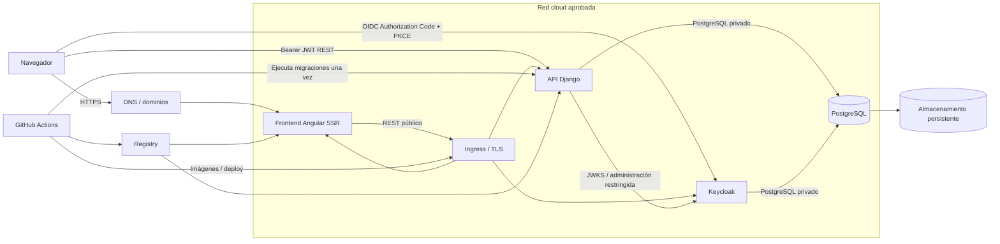

# Diseño de despliegue cloud de Piedrazul

**Estado:** arquitectura objetivo independiente de proveedor  
**Proveedor:** pendiente de selección por costo, tarjeta y cuota disponibles  
**Restricción:** sin requerimiento de tarjeta ni add-ons de pago

## 1. Objetivo

Desplegar el sistema para demostración académica con:

- Angular SSR accesible por HTTPS.
- API Django REST accesible por HTTPS.
- Keycloak por HTTPS.
- PostgreSQL privado y persistente.
- Identidad separada de datos de negocio.
- Imágenes reproducibles desplegadas por CI/CD.
- Respaldos y rollback definidos.

No se declara proveedor hasta verificar la oferta gratuita actual.

## 2. Diagrama de arquitectura física



## 3. Topología objetivo

| Componente | Ejecutable objetivo | Puerto interno | Acceso |
|---|---|---|---|
| Frontend | Angular SSR Node | `4000` por defecto, configurable por `PORT` | Público HTTPS |
| API | Django con servidor WSGI | `8000` | Público HTTPS |
| Keycloak | Keycloak modo producción | `8080` | Público HTTPS con administración restringida |
| PostgreSQL | Servicio administrado o contenedor persistente | `5432` | Solo red privada |
| Registro | Registry gratuito incluido o GHCR | N/A | Acceso desde CI y runtime |

## 4. Dominios sugeridos

Los nombres reales son pendientes:

```text
https://app.piedrazul.<proveedor>
https://api.piedrazul.<proveedor>
https://auth.piedrazul.<proveedor>
```

No usar `localhost` en ningún navegador, issuer, CORS o callback del entorno cloud.

## 5. Flujo de identidad

1. Angular inicia Authorization Code + PKCE.
2. Keycloak autentica al usuario.
3. Keycloak entrega el código y Angular obtiene los tokens.
4. Angular envía `Authorization: Bearer <JWT>` a Django.
5. Django valida issuer, firma JWKS, expiración y roles.
6. Django deriva alcance por usuario, paciente o profesional.
7. Keycloak administra usuarios desde credenciales de servicio solo por red backend.

## 6. DNS, TLS y CORS

- TLS obligatorio en los tres dominios.
- CORS debe permitir solo el origen HTTPS real de Angular.
- Keycloak valid redirect URIs debe listar:
  - origen exacto del frontend.
  - callback esperado por Keycloak JS.
- No usar comodines en producción.
- Backend `ALLOWED_HOSTS` debe contener solo dominios y nombres internos necesarios.

## 7. Configuración Django

Variables obligatorias:

```text
DJANGO_DEBUG=False
DJANGO_SECRET_KEY
DJANGO_ALLOWED_HOSTS
DB_NAME
DB_USER
DB_PASSWORD
DB_HOST
DB_PORT
KEYCLOAK_URL
KEYCLOAK_ISSUER
KEYCLOAK_JWKS_URL
KEYCLOAK_ADMIN
KEYCLOAK_ADMIN_PASSWORD
```

Modificaciones recomendadas:

- Servidor WSGI con Gunicorn.
- `collectstatic` si se sirve contenido administrativo.
- Health endpoint sin credenciales.
- Logging estructurado sin datos personales ni motivos de cancelación.
- CORS configurado desde variables.
- Prohibir el fallback de secrets locales en producción.

## 8. Configuración Angular

La construcción cloud debe recibir:

```text
API_URL
KEYCLOAK_URL
KEYCLOAK_REALM
KEYCLOAK_CLIENT_ID
```

Implementar configuración en tiempo de ejecución si el mismo artefacto se puede desplegar en varios entornos. Si se configura en build, documentar el origen exacto y eliminar `environment.prod.ts` con dominios ficticios.

## 9. PostgreSQL

Separar cuando el proveedor lo permita:

- `piedra_db`: datos funcionales.
- `keycloak_db`: identidad y configuración.

Credenciales separadas para:

- Backend.
- Keycloak.
- Operaciones de respaldo.

El puerto `5432` no debe estar público. PostgreSQL debe tener volumen o servicio administrado persistente.

## 10. Keycloak en producción

Sustituir Compose actual:

- `start-dev` por `start` o configuración equivalente.
- HTTP interno permitido solo detrás de proxy.
- Hostname público HTTPS.
- Base PostgreSQL persistente.
- Credenciales administrativas fuera del entorno frontend.
- Realm versionado.
- Usuarios demo distintos de credenciales administrativas.
- Bloqueo del puerto administrativo público.
- Tema persistente como volumen o imagen.

## 11. Dockerfiles de producción

### Backend

Debe incluir:

- Python 3.13 slim.
- Usuario no root.
- Dependencias bloqueadas.
- No bind mounts.
- Gunicorn.
- Migraciones fuera de runtime.
- Healthcheck.

Ejemplo conceptual:

```text
python manage.py collectstatic --noinput
gunicorn config.wsgi:application --bind 0.0.0.0:8000
```

### Frontend

Debe incluir:

- Node 24 para build.
- `npm ci`.
- Build Angular SSR de producción.
- Usuario no root.
- `PORT` configurable.
- Healthcheck.
- No `ng serve`.

### Keycloak

Usar la imagen oficial con configuración del realm y tema. La imagen custom solo si el proveedor no permite mounts.

## 12. Persistencia y respaldo

Crear procesos documentados para:

1. Respaldo lógico de `piedra_db`.
2. Respaldo lógico de `keycloak_db`.
3. Retención mínima acordada.
4. Prueba de restauración.
5. Registro sin secretos ni datos personales.

La restauración de base nunca debe ejecutarse automáticamente desde el pipeline.

## 13. Monitoreo mínimo

No obligatorio por rúbrica, pero recomendable:

- Health check backend.
- Health check frontend.
- Estado del contenedor.
- Logs centralizados básicos.
- Alertas ante reinicios o `5xx`.
- Métrica de despliegues por SHA.

No registrar:

- Authorization Bearer.
- Cookies.
- Contraseñas.
- Motivos de cancelación.
- Datos personales innecesarios.

## 14. Criterios de proveedor cloud

Antes de elegir proveedor:

- Sin tarjeta requerida o con prueba gratuita clara.
- HTTPS disponible.
- PostgreSQL gratuito o cuota suficiente.
- Contenedores o servicios serverless disponibles.
- Persistencia versionada.
- Región disponible.
- Costos y límites publicados.
- GitHub Actions puede desplegarlo.
- Keycloak puede ejecutarse dentro de la cuota.
- Se puede restaurar una versión anterior.

Comparar al menos dos opciones y registrar la decisión en un ADR.

## 15. Opciones de despliegue recomendadas

El agente puede seleccionar una opción solo después de comprobar cuotas vigentes:

1. Contenedores de tres servicios más PostgreSQL administrado.
2. Frontend estático más SSR evaluado; API y Keycloak como contenedores.
3. Plataforma PaaS con servicios administrados.

No presentar una opción como aprobada si no existe confirmación oficial de costo y cuota.

## 16. Criterios de aceptación

- Ningún puerto de PostgreSQL o administración Keycloak queda público.
- El navegador usa tres dominios HTTPS o rutas justificadas.
- El issuer JWT coincide con el dominio público real.
- CORS permite únicamente el frontend real.
- El backend no usa `runserver`.
- Keycloak no usa `start-dev`.
- Las migraciones se ejecutan fuera de los contenedores de API.
- El despliegue conserva datos.
- Existe rollback.
- El ambiente usa datos sintéticos.
- No hay secretos en imágenes, logs o repositorio.
