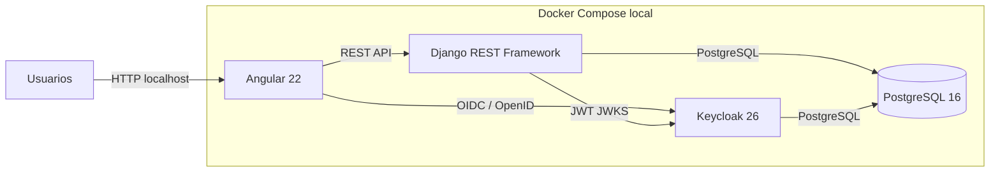
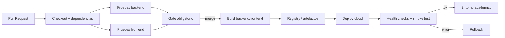

# Estado actual del proyecto Piedrazul

**Fecha de corte:** 2026-11-19  
**Repositorio:** `Jonax74/Piedra-Azul-2`  
**Rama principal de trabajo:** `develop`  
**Repositorio remoto:** GitHub

## 1. Propósito

Este documento describe la línea base técnica comprobable antes de diseñar o implementar CI/CD y despliegue cloud. Debe usarse junto con:

- `README.MD`
- `docker-compose.yml`
- `Guia_Diagramas_Arquitectura_CI_CD_Despliegue.md`
- `EntregablesTercerCorte2026.md`
- `Guia_Entregable_Tercer_Corte_2026.md`

Ante una diferencia, prevalece el código ejecutable y este documento debe actualizarse.

## 2. Arquitectura actual



## 3. Componentes existentes

| Componente | Tecnología / versión observada | Estado actual |
|---|---|---|
| Frontend | Angular 22, Angular SSR, Bootstrap 5.3, Keycloak JS, Vitest | Disponible; actualmente usa `ng serve` en Compose |
| Backend | Python 3.13, Django 6.1.1, Django REST Framework | Disponible; Compose usa `runserver` |
| Identidad | Keycloak 26.0 | Disponible en modo `start-dev`; importa realm `piedrazul` |
| Base de datos | PostgreSQL 16 Alpine | Disponible localmente; volumen persistente |
| Contenedorización | Docker Compose v2 | Existe para desarrollo local |
| CI/CD | GitHub Actions | No existe workflow comprobado en `.github/workflows` |
| Infraestructura como código | Ninguna | No existe Terraform, Bicep, Kubernetes ni IaC equivalente |
| Hosting cloud | Ninguno seleccionado | No existen URLs ni cuenta proveedor confirmadas |

## 4. Servicios Docker actuales

| Servicio | Imagen / build | Puerto host | Persistencia |
|---|---|---|---|
| `postgres` | `postgres:16-alpine` | `5432` | `postgres_data` |
| `keycloak` | `quay.io/keycloak/keycloak:26.0` | `8080` | Recurso de PostgreSQL; imports montados |
| `backend` | `./backend/Dockerfile` | `8000` | Bind mount de código |
| `frontend` | `./frontend-app/Dockerfile` | `4200` | Bind mount y volumen de `node_modules` |

El backend aplica migraciones al arrancar mediante:

```text
python manage.py migrate --noinput
python manage.py runserver 0.0.0.0:8000
```

## 5. Estado de seguridad y configuración

- Existe `.env.example` con valores locales de PostgreSQL, Keycloak y Django.
- Los secretos reales no deben almacenarse en Git.
- `.gitignore` excluye `.env`, llaves, certificados, entornos virtuales y reportes ZAP.
- Django admite variables para debug, hosts permitidos, secret key y PostgreSQL.
- CORS está limitado a `localhost:4200` y `127.0.0.1:4200`.
- Keycloak usa las URLs internas del Compose y, en el navegador, `localhost`.
- El entorno de producción debe reemplazar credenciales locales, debug, CORS, issuer y hosts permitidos.
- El archivo `environment.prod.ts` contiene dominios ficticios `piedrazul.example`.

## 6. Pruebas existentes

### Backend

Se encontraron pruebas Django/DRF en los módulos `users`, `persons`, `appointments`, `notifications` y `common`.

Comando objetivo:

```powershell
cd backend
python manage.py test
```

En CI debe ejecutarse preferiblemente dentro del contenedor:

```powershell
docker compose run --rm backend python manage.py test
```

### Frontend

Existe Angular/Vitest y pruebas `.spec.ts` para páginas, servicios, guards e interceptores.

Comandos objetivo:

```powershell
cd frontend-app
npm ci
npm run build
npm test -- --watch=false
```

La ejecución exacta de tests en CI debe validarse contra el comportamiento real de Angular 22 antes de fijar banderas.

## 7. Diagrama de pipeline esperado

Este diagrama representa el objetivo, no el estado implementado.



## 8. Brechas conocidas

1. Falta `.github/workflows/`.
2. Falta Dockerfile de producción verificable para SSR Angular.
3. Falta imagen de ejecución para Django con Gunicorn/uWSGI y archivos estáticos.
4. Compose usa bind mounts y servidores de desarrollo.
5. Falta configuración dinámica de frontend para API, Keycloak y dominio.
6. No existe un `health endpoint` específico y liviano además de `/admin/login/`.
7. No hay migraciones ejecutadas una sola vez en un job separado de despliegue.
8. Keycloak no está configurado para modo de producción, HTTPS público ni secretos administrados.
9. PostgreSQL no tiene política versionada de respaldos y restauración.
10. No existe monitoreo, alertas ni dashboard obligatorio.
11. No existe revisión de dependencias, escaneo de imágenes ni escaneo ZAP integrado.
12. Falta elegir proveedor cloud gratuito sin requisito de tarjeta.

## 9. Requisitos funcionales que el despliegue debe cubrir

- JWT con Keycloak y autorización por rol.
- Cancela citas con mínimo 48 horas y justificación obligatoria.
- Reportes agregados por año, mes, profesional y estado.
- Roles: `PACIENTE`, `AGENDADOR`, `MEDICO`, `ADMIN`.
- Datos sintéticos o controlados en el entorno académico.

## 10. Criterio de cierre del estado actual

La línea base queda reconocida cuando una IA o agente confirma:

- Rama `develop` y remoto GitHub.
- Angular, Django, Keycloak y PostgreSQL identificados.
- Desarrollo local reproducible por Docker Compose.
- Pipeline e infraestructura como código inexistentes.
- No existe proveedor cloud ni URL de producción confirmados.
- Las pruebas están presentes pero no se presupone que estén pasando sin ejecutarlas.
